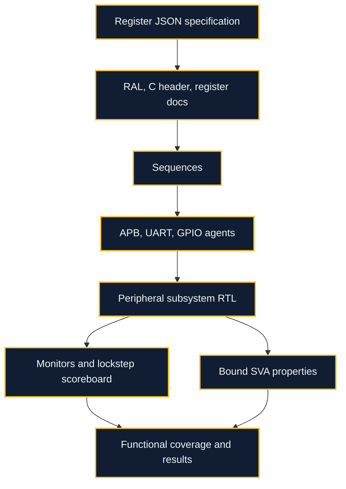

# APB SoC Verification

**SystemVerilog / SVA · pyuvm / cocotb · RAL · Mutation testing**

A verification environment for an APB peripheral subsystem that asks **whether its checks can detect the bugs they are intended to catch**.

The DUT contains an address decoder, UART, timer, GPIO, and interrupt controller. The main pyuvm testbench combines bus agents, an independent UART monitor, a cycle-level reference model, register sequences, assertions, and coverage. A smaller native SystemVerilog UVM bench provides a separate implementation path.

**Status:** simulation-tested on Verilator. The main pyuvm environment and the compact native UVM bench have different feature coverage and are documented separately.

[Engineering](#engineering-highlights) · [Architecture](#architecture) · [Evidence](#recorded-results) · [Run locally](#run-locally) · [Scope](#scope-and-next-steps)

## Engineering highlights

- **A plan connects features to checks.** Stimulus, scoreboards, assertions, and coverage bins are mapped to specific peripheral behavior.
- **Outputs are checked every cycle.** The lockstep scoreboard compares APB responses, GPIO, UART output, and interrupts against a reference model.
- **Independent checks reduce shared assumptions.** A UART decoder and direct specification checks supplement the cycle model.
- **Registers have one machine-readable specification.** JSON generates the RAL model, C header, and documentation; reset, mirror, bit-bash, and W1C tests check agreement with RTL.
- **Mutation campaigns challenge detection.** Injected protocol, peripheral, and register defects establish which checks actually fire.

## Architecture



This is a peripheral subsystem, not a CPU-containing SoC. The testbench acts as APB master. Assertions are simulation checks rather than formal proofs.

## Recorded results

The recorded [verification plan](docs/verification_plan.md), [results](results/2026-10-15/), and [native-bench report](docs/sv_uvm.md) show:

| Check | Recorded result | Boundary |
|---|---|---|
| Seeded regression | 10 seeds × 9 tests passed | Main pyuvm environment |
| Functional coverage | 82/82 defined bins | Coverage model completeness is not proven |
| Injected RTL defects | 12/12 detected | The selected mutation set |
| SVA activation | 21/21 testable properties fired on target bugs | Two no-X properties cannot fail in two-state Verilator |
| Native SV UVM | Runs with Verilator 5.052 and UVM 2020.3.1 | Smaller bench: two tests, ten manual bins, no RAL |

The native bench uses `$urandom`, not constrained `randomize()` stimulus, and manual bin counters rather than covergroups. The 82-bin and RAL claims belong to the pyuvm environment.

## Run locally

Requirements: Python 3, Make, C++ tools, and Verilator 5.020 or later for the main bench. From this project directory:

```bash
python3 -m venv .venv
source .venv/bin/activate
pip install -r tb/requirements.txt
(cd tb && make SIM=verilator)
python3 tools/regress.py --seeds 10 --bugs --sva-bugs --ral-bugs
python3 tools/reggen.py
```

The subshell keeps the regression command at the project root. `reggen.py` regenerates the register artifacts; review any differences rather than treating regeneration as a test of the RTL itself.

The native UVM path requires its separately documented toolchain and `UVM_HOME`; follow [docs/sv_uvm.md](docs/sv_uvm.md). A commercial simulator is not needed for the main pyuvm flow.

## Read the implementation

| Start here | What to inspect |
|---|---|
| [`tb/refmodel.py`](tb/refmodel.py) | Cycle-level reference model |
| [`tb/ral.py`](tb/ral.py) | Register sequences and checks |
| [`sva/soc_sva.sv`](sva/soc_sva.sv) | Concurrent assertions |
| [`regs/periph_soc.json`](regs/periph_soc.json) | Single register specification |
| [`sv_uvm`](sv_uvm) | Native SystemVerilog UVM bench |

## Scope and next steps

- No commercial-simulator validation, formal proof, or four-state activation of the no-X assertions.
- The native SV UVM bench is intentionally smaller and does not establish the main bench’s RAL or peripheral coverage.
- RTL and reference model share an author and specification, so correlated mistakes remain possible.
- Verilator’s supported assertion subset limits temporal-expression choices.
- Next priorities: commercial/four-state runs, stronger independent specifications, broader mutations, and deeper native UVM/RAL coverage.

## Documentation

- [Verification plan](docs/verification_plan.md)
- [Generated register map](docs/register_map.md)
- [Native UVM status](docs/sv_uvm.md)
- [Recorded regression outputs](results/2026-10-15)
- [Limitations](docs/limitations.md)
- [Further simulator validation](docs/OWNER_ACTIONS.md)
